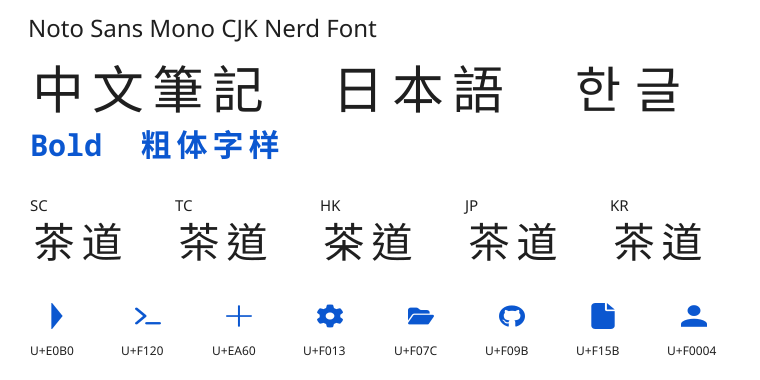
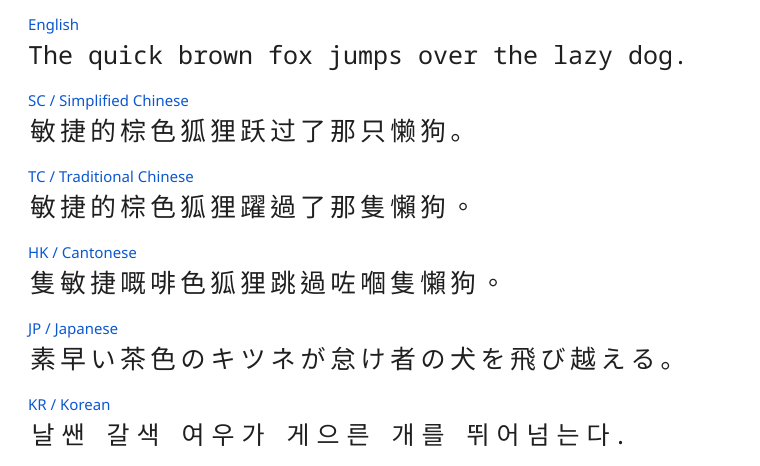
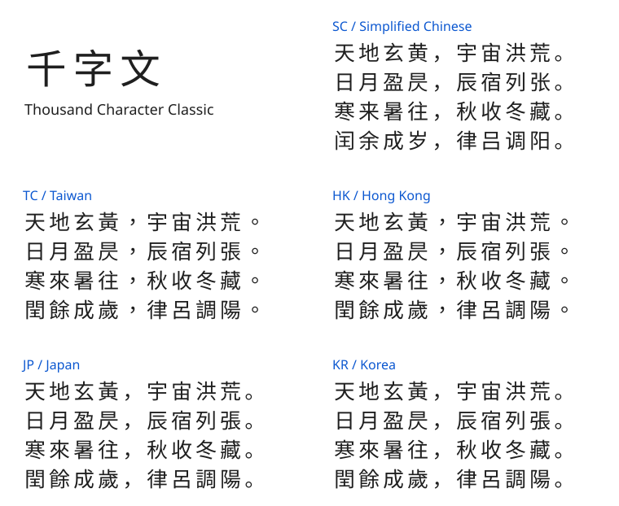
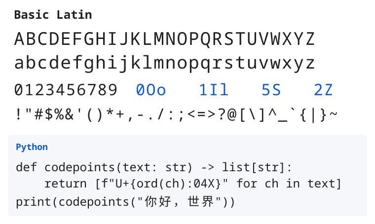

# Noto Sans Mono CJK Nerd Font

[English](README.md) · [简体中文](README.zh-Hans.md) · [繁體中文](README.zh-Hant.md) · [한국어](README.ko.md) · **日本語**

コードやターミナルで、日本語・中国語・韓国語と欧文を一緒に使うための等幅フォントです。NotoSansM Nerd Font Mono の英数字に、Noto CJK の地域ごとの字形と Nerd Fonts のアイコンを組み合わせました。ターミナルでは英字が1列、全角の漢字が2列を占めるので、日本語のコメントを含むコードでも桁が揃います。

[追加されたグリフを Unicode コードポイント順に見る](docs/glyphs/README.md)

## フォントの選び方

普段見慣れている漢字や句読点の形で選んでください。日本語には **JP**、繁体字中国語で台湾の字形を使うなら **TC**、香港の字形を使うなら **HK** が適しています。複数の版をインストールして、アプリごとに使い分けることもできます。

| 主に使う言語 | ダウンロード | アプリで選ぶフォント名 |
| --- | --- | --- |
| 中国語（簡体字） | `NotoSansMonoCJKSCNF.zip` | Noto Sans Mono CJK SC Nerd Font |
| 中国語（繁体字・台湾） | `NotoSansMonoCJKTCNF.zip` | Noto Sans Mono CJK TC Nerd Font |
| 中国語（繁体字・香港） | `NotoSansMonoCJKHKNF.zip` | Noto Sans Mono CJK HK Nerd Font |
| 日本語 | `NotoSansMonoCJKJPNF.zip` | Noto Sans Mono CJK JP Nerd Font |
| 韓国語 | `NotoSansMonoCJKKRNF.zip` | Noto Sans Mono CJK KR Nerd Font |

## インストール

1. [リリースページ](https://github.com/Ginkgoty/noto-sans-mono-cjk-nerd-font/releases/latest)から使いたい版の ZIP ファイルをダウンロードして展開します。各 ZIP には Regular（標準）と Bold（太字）の2つのフォントファイルが入っています。
2. Windows または macOS では、2つの `.otf` ファイルをそれぞれ開いてインストールします。Linux では `~/.local/share/fonts/` に両方のファイルをコピーし、`fc-cache` を実行します。ディレクトリがなければ先に作成してください。
3. エディターやターミナルを開き直し、フォント設定で上の表にあるフォント名を選びます。太字を表示する際は Bold が自動的に使われます。

## フォントのビルドと変更

[開発ガイド（英語）](docs/development.md)では、地域別フォントのビルド、字形やアイコンの変更、見本と配布用 ZIP の作成方法を説明しています。

## クレジットとライセンス

Noto と Nerd Fonts を基にしたコミュニティプロジェクトです。Noto は Google の商標です。フォントは SIL Open Font License 1.1 で配布しています。作者と各素材の利用条件は[フォントとアイコンのライセンス](licenses/)をご覧ください。ビルドスクリプトには [MIT ライセンス](LICENSE)が適用されます。
