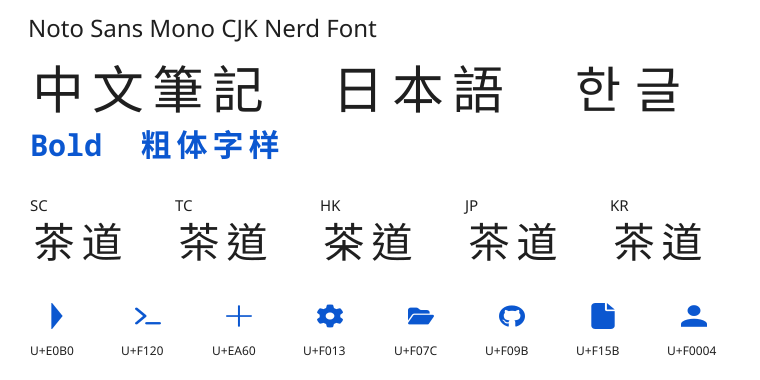
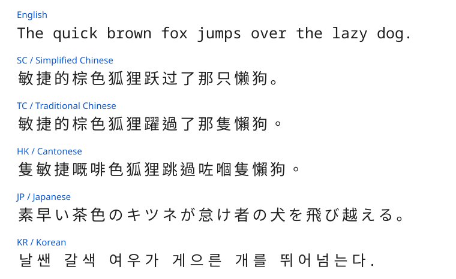
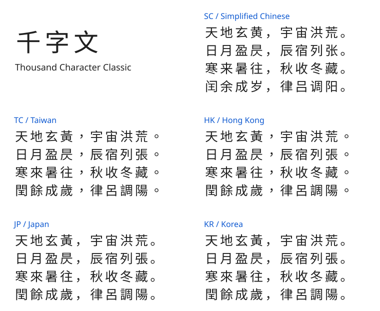
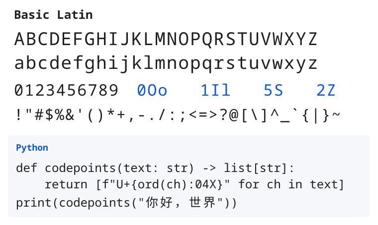

# Noto Sans Mono CJK Nerd Font

[English](README.md) · [简体中文](README.zh-Hans.md) · [繁體中文](README.zh-Hant.md) · **한국어** · [日本語](README.ja.md)

코드와 터미널에서 한글, 한자, 가나를 영문과 함께 쓰기 좋은 고정폭 글꼴입니다. NotoSansM Nerd Font Mono의 영문자와 숫자에 Noto CJK의 지역별 글자 모양과 Nerd Fonts 아이콘을 더했습니다. 터미널에서 영문자는 한 칸, 한글 음절과 전각 한자는 두 칸을 차지해 코드와 주석의 열이 가지런히 맞습니다.

[유니코드 코드 포인트순으로 추가된 글리프 보기](docs/glyphs/README.md)

## 글꼴 선택

평소에 쓰는 한자와 문장 부호의 모양을 기준으로 고르세요. 한국어에는 **KR**을, 중국어 번체에는 대만식 표기라면 **TC**, 홍콩식 표기라면 **HK**를 선택하면 됩니다. 여러 버전을 함께 설치하고 앱마다 다른 글꼴을 쓸 수도 있습니다.

| 주로 쓰는 언어 | 다운로드 | 앱에서 선택할 글꼴 이름 |
| --- | --- | --- |
| 중국어 간체 | `NotoSansMonoCJKSCNF.zip` | Noto Sans Mono CJK SC Nerd Font |
| 중국어 번체(대만) | `NotoSansMonoCJKTCNF.zip` | Noto Sans Mono CJK TC Nerd Font |
| 중국어 번체(홍콩) | `NotoSansMonoCJKHKNF.zip` | Noto Sans Mono CJK HK Nerd Font |
| 일본어 | `NotoSansMonoCJKJPNF.zip` | Noto Sans Mono CJK JP Nerd Font |
| 한국어 | `NotoSansMonoCJKKRNF.zip` | Noto Sans Mono CJK KR Nerd Font |

## 설치

1. [릴리스 페이지](https://github.com/Ginkgoty/noto-sans-mono-cjk-nerd-font/releases/latest)에서 원하는 ZIP 파일을 내려받아 압축을 풉니다. 각 파일에는 Regular(보통)와 Bold(굵게) 두 가지 굵기가 들어 있습니다.
2. Windows나 macOS에서는 `.otf` 파일 두 개를 각각 열어 설치합니다. Linux에서는 두 파일을 `~/.local/share/fonts/`에 복사한 뒤 `fc-cache`를 실행합니다. 디렉터리가 없으면 먼저 만드세요.
3. 편집기나 터미널을 다시 열고 글꼴 설정에서 위 표에 나온 이름을 선택합니다. 굵은 글씨에는 앱이 자동으로 Bold를 사용합니다.

## 글꼴 빌드 및 수정

[개발 안내서(영문)](docs/development.md)에서 지역별 글꼴을 빌드하고, 글자 모양이나 아이콘을 바꾸고, 견본과 배포 파일을 만드는 방법을 설명합니다.

## 제작 및 라이선스

Noto와 Nerd Fonts를 바탕으로 만든 커뮤니티 프로젝트입니다. Noto는 Google의 상표입니다. 글꼴은 SIL Open Font License 1.1로 배포합니다. 원작자와 각 리소스의 이용 조건은 [글꼴 및 아이콘 라이선스](licenses/)에서 확인할 수 있습니다. 빌드 스크립트에는 [MIT 라이선스](LICENSE)가 적용됩니다.
