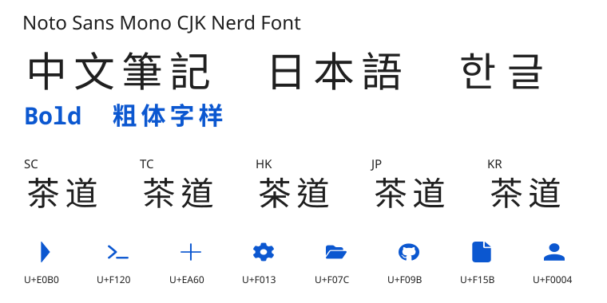
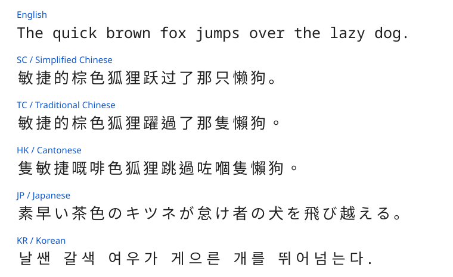
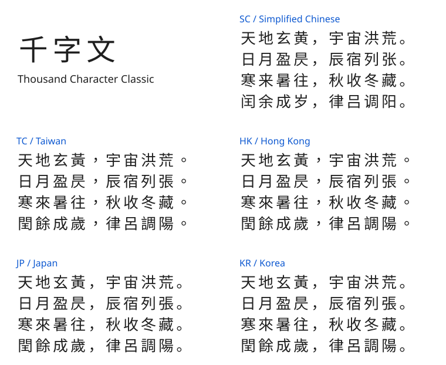
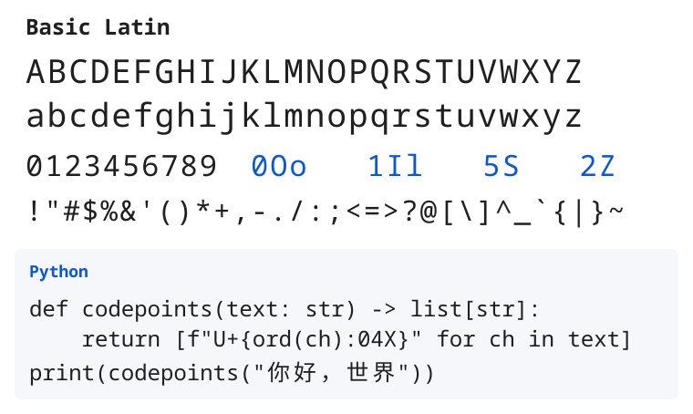

# Noto Sans Mono CJK Nerd Font

**English** · [简体中文](README.zh-Hans.md) · [繁體中文](README.zh-Hant.md) · [한국어](README.ko.md) · [日本語](README.ja.md)

A monospace font for people who use Chinese, Japanese, or Korean alongside
code. It pairs the Latin letters and numbers from NotoSansM Nerd Font Mono
with regional Noto CJK characters and Nerd Fonts icons. In a terminal, a Latin
letter takes one column and a full-width Han character takes two, so comments,
prompts, and code line up.

[Browse all added glyphs by Unicode code point](docs/glyphs/README.md).

## Choose your font

Pick the edition whose character shapes and punctuation look most familiar to
you. For example, if you write Traditional Chinese, choose **TC** for Taiwan
or **HK** for Hong Kong. You can install more than one edition and choose a
different one in each app.

| If you usually write | Download | Select this font in your app |
| --- | --- | --- |
| Simplified Chinese | `NotoSansMonoCJKSCNF.zip` | Noto Sans Mono CJK SC Nerd Font |
| Traditional Chinese (Taiwan) | `NotoSansMonoCJKTCNF.zip` | Noto Sans Mono CJK TC Nerd Font |
| Traditional Chinese (Hong Kong) | `NotoSansMonoCJKHKNF.zip` | Noto Sans Mono CJK HK Nerd Font |
| Japanese | `NotoSansMonoCJKJPNF.zip` | Noto Sans Mono CJK JP Nerd Font |
| Korean | `NotoSansMonoCJKKRNF.zip` | Noto Sans Mono CJK KR Nerd Font |

## Install

1. Download your ZIP from the project's [GitHub Releases page](https://github.com/Ginkgoty/noto-sans-mono-cjk-nerd-font/releases/latest) and extract it.
   Each ZIP contains two font files, Regular and Bold.
2. On Windows or macOS, open each `.otf` file and choose **Install**. On Linux,
   copy both files into `~/.local/share/fonts/` (create the directory if needed)
   and run `fc-cache`.
3. Reopen your editor or terminal, then choose the family name from the table
   in its font settings. The app will use Bold automatically for bold text.

## Building or adapting the font

The [development guide](docs/development.md) explains how to build one edition,
change the lettering or icons, and generate the samples and release archives.

## Credits and licenses

This is a community project based on Noto and Nerd Fonts. Noto is a trademark
of Google. The fonts use the SIL Open Font License 1.1. See the
[font and icon credits](licenses/) for attribution and the licenses for the
included artwork. The build scripts use the [MIT License](LICENSE).
