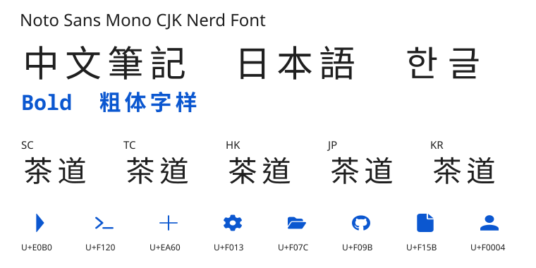
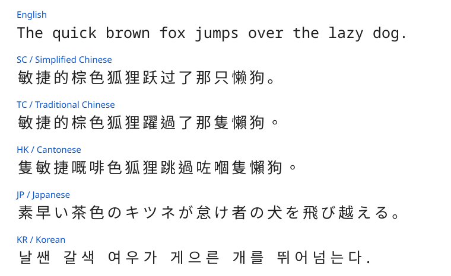
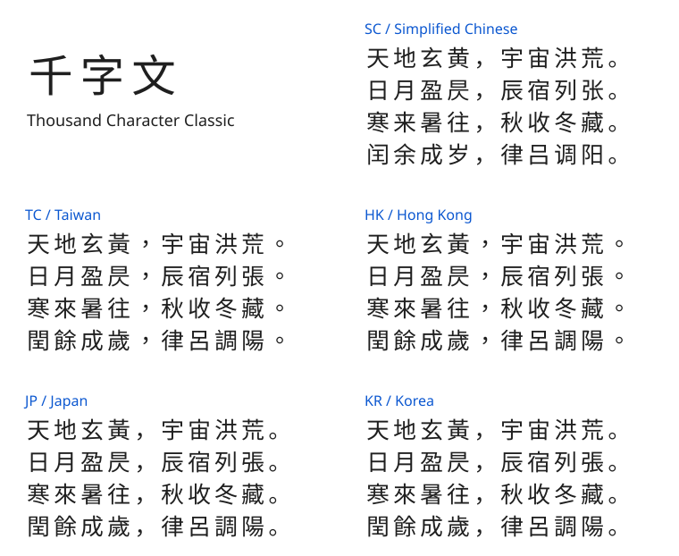
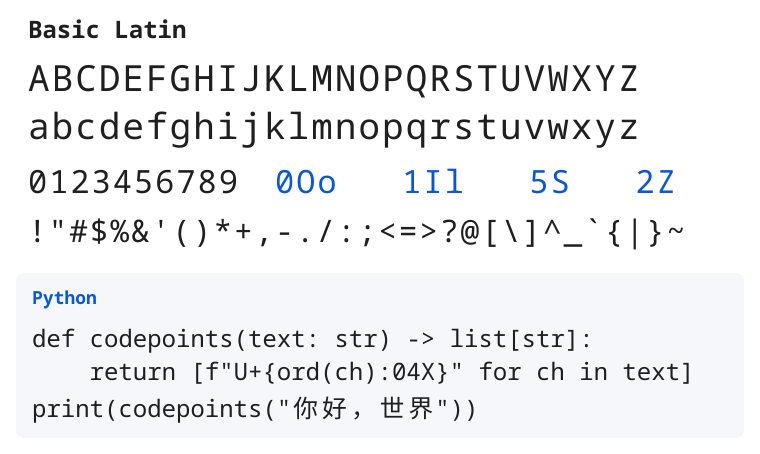

# Noto Sans Mono CJK Nerd Font

[English](README.md) · **简体中文** · [繁體中文](README.zh-Hant.md) · [한국어](README.ko.md) · [日本語](README.ja.md)

这是一款适合在代码和终端里混排中文、日文、韩文和西文的等宽字体。拉丁字母和数字取自 NotoSansM Nerd Font Mono，搭配 Noto CJK 的地区字形和 Nerd Fonts 图标。在终端里，一个拉丁字母占一列，一个全角汉字占两列，代码和注释都能对齐。

[按 Unicode 码位浏览新增字形](docs/glyphs/README.md)

## 选择字体

按你平时习惯的字形和标点来选。例如，同样写繁体中文，习惯台湾写法可以选 **TC**，习惯香港写法可以选 **HK**。也可以同时安装多个版本，在不同应用里分别选择。

| 常用语言 | 下载 | 在应用中选择的字体名称 |
| --- | --- | --- |
| 简体中文 | `NotoSansMonoCJKSCNF.zip` | Noto Sans Mono CJK SC Nerd Font |
| 繁体中文（台湾） | `NotoSansMonoCJKTCNF.zip` | Noto Sans Mono CJK TC Nerd Font |
| 繁体中文（香港） | `NotoSansMonoCJKHKNF.zip` | Noto Sans Mono CJK HK Nerd Font |
| 日语 | `NotoSansMonoCJKJPNF.zip` | Noto Sans Mono CJK JP Nerd Font |
| 韩语 | `NotoSansMonoCJKKRNF.zip` | Noto Sans Mono CJK KR Nerd Font |

## 安装

1. 从[发布页面](https://github.com/Ginkgoty/noto-sans-mono-cjk-nerd-font/releases/latest)下载对应的 ZIP 并解压。每个包里都有 Regular（常规）和 Bold（粗体）两个字体文件。
2. 在 Windows 或 macOS 上，分别打开两个 `.otf` 文件，点击安装。在 Linux 上，将它们复制到 `~/.local/share/fonts/`（如果目录不存在，先创建），然后运行 `fc-cache`。
3. 重新打开编辑器或终端，在字体设置中选择上表列出的字体名称。需要显示粗体时，应用会自动使用 Bold。

## 构建或修改字体

[开发指南（英文）](docs/development.md)介绍了如何构建单个地区版本、调整字形或图标，以及生成样张和发布包。

## 致谢与许可

本项目由社区维护，基于 Noto 和 Nerd Fonts。Noto 是 Google 的商标。字体采用 SIL Open Font License 1.1。[字体与图标许可说明](licenses/)列出了作者和所用素材的许可条款。构建脚本采用 [MIT 许可证](LICENSE)。
