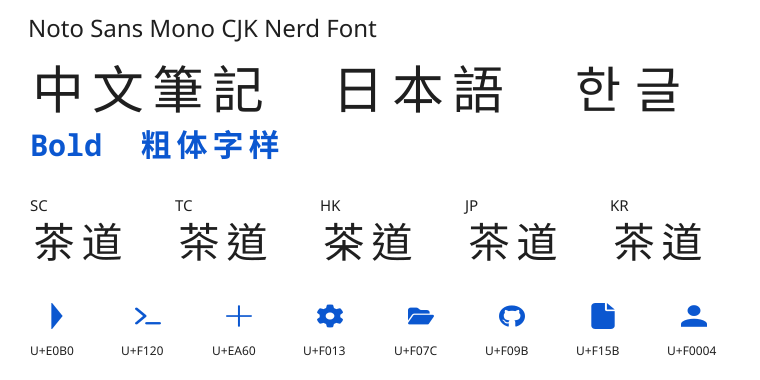
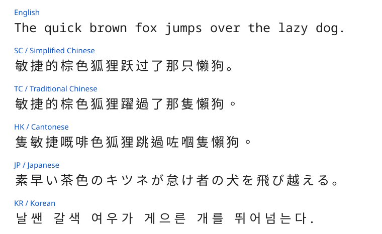
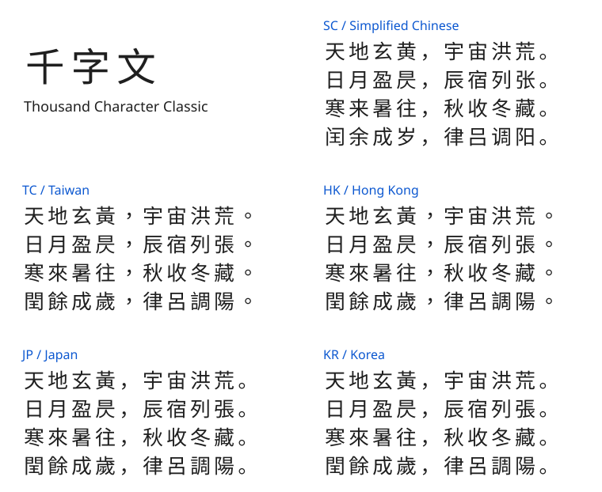
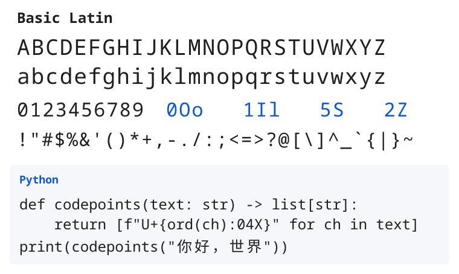

# Noto Sans Mono CJK Nerd Font

[English](README.md) · [简体中文](README.zh-Hans.md) · **繁體中文** · [한국어](README.ko.md) · [日本語](README.ja.md)

這款等寬字型適合在程式碼和終端機裡混排中文、日文、韓文與西文。拉丁字母和數字取自 NotoSansM Nerd Font Mono，搭配 Noto CJK 各地區的字形與 Nerd Fonts 圖示。在終端機裡，一個拉丁字母佔一格，一個全形漢字佔兩格，程式碼和註解都能對齊。

[依 Unicode 碼位瀏覽新增字形](docs/glyphs/README.md)

## 選擇字型

請依平常習慣的字形和標點選擇版本。例如，同樣使用繁體中文，習慣臺灣寫法可以選 **TC**，習慣香港寫法可以選 **HK**。也可以同時安裝多個版本，在不同的應用程式裡各自選用。

| 常用語言 | 下載 | 在應用程式中選用的字型名稱 |
| --- | --- | --- |
| 簡體中文 | `NotoSansMonoCJKSCNF.zip` | Noto Sans Mono CJK SC Nerd Font |
| 繁體中文（臺灣） | `NotoSansMonoCJKTCNF.zip` | Noto Sans Mono CJK TC Nerd Font |
| 繁體中文（香港） | `NotoSansMonoCJKHKNF.zip` | Noto Sans Mono CJK HK Nerd Font |
| 日文 | `NotoSansMonoCJKJPNF.zip` | Noto Sans Mono CJK JP Nerd Font |
| 韓文 | `NotoSansMonoCJKKRNF.zip` | Noto Sans Mono CJK KR Nerd Font |

## 安裝方式

1. 從[版本發布頁面](https://github.com/Ginkgoty/noto-sans-mono-cjk-nerd-font/releases/latest)下載對應的 ZIP 檔並解壓縮。每個壓縮檔都包含 Regular（一般）和 Bold（粗體）兩個字型檔。
2. 在 Windows 或 macOS 上，分別開啟兩個 `.otf` 檔並安裝。在 Linux 上，將兩個檔案複製到 `~/.local/share/fonts/`（若目錄不存在，請先建立），再執行 `fc-cache`。
3. 重新開啟編輯器或終端機，在字型設定中選取上表列出的名稱。顯示粗體時，應用程式會自動使用 Bold。

## 建置或修改字型

[開發指南（英文）](docs/development.md)介紹如何建置單一地區的字型、調整字形或圖示，以及產生字型樣張與發行用的壓縮檔。

## 致謝與授權

本專案由社群維護，以 Noto 和 Nerd Fonts 為基礎。Noto 是 Google 的商標。字型採用 SIL Open Font License 1.1 授權。[字型與圖示授權說明](licenses/)列出作者及各項素材的授權條款。建置腳本採用 [MIT 授權條款](LICENSE)。
